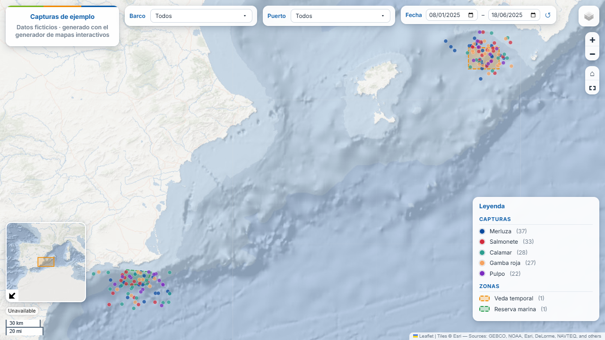

<div align="center">


# Generador de mapas interactivos

Aplicación local que convierte tablas de posiciones y capas GIS en un mapa web interactivo, guardado en un único archivo HTML que se abre en cualquier navegador.

[](https://juliouq.github.io/Portfolio-Web---JulioUQ/es/casos/generador-de-mapas/demo/)

    



<sub>Mapa generado con la aplicación a partir de datos ficticios.</sub>

</div>

---

## Descripción general

Preparar un mapa para compartir datos con posiciones suele exigir programar o instalar un SIG. Esta aplicación lo resuelve con una interfaz web en tres pasos: se cargan las posiciones y las capas, se elige el estilo y se descarga el mapa.

El resultado es un HTML autónomo con filtros, leyenda y capas activables. Quien lo recibe solo necesita un navegador; no tiene que instalar la aplicación.

## Funcionalidades

- **Posiciones en varios formatos:** Excel, CSV, Parquet o puntos en GeoPackage y GeoJSON. Se pueden combinar varios conjuntos, cada uno con su leyenda y sus filtros.
- **Capas propias:** polígonos, líneas o puntos en SHP, GPKG, GeoJSON, KML, GML, FGB o ZIP. Al elegir un `.shp` se recogen solos sus archivos asociados.
- **Capas de referencia:** GSA, FAO, ZEE y países, leídas desde una carpeta configurable.
- **Estilo:** color único, por categorías o por rangos numéricos, con un emoji opcional como icono.
- **Interactividad en el mapa:** filtros con búsqueda, filtro por fechas, ventanas emergentes configurables, control de capas, leyenda, minimapa y coordenadas del cursor.
- **Mapas reproducibles:** además del HTML, la aplicación descarga un script de Python que regenera el mismo mapa con datos nuevos.

## Tecnologías y herramientas

| Ámbito | Herramientas |
| --- | --- |
| Interfaz | Streamlit |
| Mapa | Folium (Leaflet) |
| Datos geoespaciales | GeoPandas, pyogrio |
| Tablas | pandas, NumPy, openpyxl, python-calamine |
| Arranque en Windows | Scripts `.bat` que preparan el entorno la primera vez |

## Estructura del proyecto

```text
.
├── app.py                 # Interfaz web en tres pestañas: Posiciones, Capas, Título y mapa
├── mapas/
│   ├── motor.py           # Construye el mapa con Folium; también funciona por consola
│   ├── core.py            # Capas de referencia, subida de archivos y script de regeneración
│   └── geo.py             # Lectura de las capas GIS de referencia
├── scripts/
│   ├── Iniciar_Mapas.bat  # Prepara el entorno la primera vez y abre la aplicación
│   ├── Crear_paquete.bat  # Empaqueta la aplicación para distribuirla
│   └── Actualizar_wheels.bat
├── tests/EJERCICIO.md     # Ejercicio guiado: primer mapa con 150 capturas ficticias
├── docs/                  # Imágenes del README
└── requirements.txt
```

## Instalación y uso

**En Windows**, la forma más sencilla es ejecutar el lanzador. La primera vez prepara el entorno e instala las dependencias; después abre la aplicación en el navegador.

```text
scripts\Iniciar_Mapas.bat
```

**En cualquier sistema**, con Python 3.10 o superior:

```bash
pip install -r requirements.txt
streamlit run app.py
```

**Por consola**, con un asistente guiado. Al terminar guarda la configuración en `<mapa>.config.json`, que permite regenerar el mapa con posiciones nuevas:

```bash
python mapas/motor.py
python mapas/motor.py --config mapa.config.json --posiciones datos_nuevos.xlsx
```

Otras opciones: `--salida RUTA.html`, `--sin-dialogos` y `--no-abrir`.

Las capas de referencia se buscan en la carpeta indicada por la variable de entorno `MAPAS_GIS_DIR`, o en la que se elija en la propia aplicación. Si la carpeta no está disponible, esas capas se omiten con un aviso.

## Resultados

- [Mapa de ejemplo en vivo](https://juliouq.github.io/Portfolio-Web---JulioUQ/es/casos/generador-de-mapas/demo/): capturas ficticias por especie, zonas de veda y reserva, y filtros por barco, puerto y fecha.
- [Caso de estudio en el portfolio](https://juliouq.github.io/Portfolio-Web---JulioUQ/es/casos/generador-de-mapas/): el problema, el diseño de la aplicación y las decisiones técnicas.

## Aspectos técnicos destacados

- Separación entre interfaz (`app.py`) y motor (`mapas/motor.py`): el mismo motor sirve a la aplicación web y a la consola.
- Salida autocontenida: un solo HTML con datos, estilos y controles, sin servidor.
- Reproducibilidad: la aplicación ofrece un script de Python y el asistente de consola guarda un `.config.json`; los dos regeneran el mapa con datos nuevos sin repetir los pasos.
- Lectura tolerante de datos reales: detección de columnas de latitud, longitud y fecha, comas decimales y varios formatos de hoja de cálculo.

## Autor

**Julio Úbeda Quesada** · Data Scientist

[](https://juliouq.github.io/Portfolio-Web---JulioUQ/es/) [](https://www.linkedin.com/in/juliouq/) [](https://github.com/JulioUQ)
